# Inference Engineering In 90 Days
A hands-on, build-in-public journey through LLM inference and infrastructure: from how a single token is generated, to GPU kernels, to serving models at scale in production.

**Note**: I'm writing it for my own revision and documentation purpose. Corrections and issues are welcome.

<br/>

## Day 1: GPU Arachitecture For Inference Engineers 

### Why We Moved from CPUs to GPUs

Until ~2004, extra transistors were used to push clock speeds higher, which made single cores faster. But power rises roughly with the cube of frequency, and chips hit a ~100W power and cooling wall, so clocks stalled while transistor counts kept growing.


*Source: [Source of the Image](https://enccs.github.io/openmp-gpu/gpu-architecture/)*


The industry pivoted from "one faster core" to "many cores," which only helps when work can be parallelized. GPUs, built for massively parallel graphics, take this idea to the extreme: thousands of simple cores instead of a few complex ones. With CUDA (2006), GPUs became programmable for general computing, and since deep learning is mostly parallel matrix math, they became the default hardware for AI.

### CPUs vs GPUs 


<br/>
CPUs optimize for fast execution of a few threads using big caches, while GPUs optimize for throughput across thousands of threads, spending transistors on computation and hiding memory latency with parallelism.

Most of the transistors in CPUs go to the cache and control units. In GPUs more focus is on processing cores. 


### Hardware Side 
**Note**: We will mostly focus on NVIDIA Volta GV100 Architecture


**PCIe 3.0 Host Interface**: the link between the GPU(device) and the host machine(CPU). Data and command enter here. 


**Giga Thread Engine**: The global schedular. It receives work from the host and hands thread blocks out to the SMs. 


Inside GPU, there are many **GPC(Graphics Processing Cluster)**, which work like a mini-GPU. Here are 6 GPCs. Inside each each GPC there are many **TPC(Texture Processing Cluster)**. Each GPC has 7 TPCs. Each TPC contains 2 SMs (one on top, one on the bottom). 


**Streaming Multiprocessors(SMs)** are the real workhorse.Each SM in Volta GV100 is divided into 4 processing blocks. There are 84 SMs inside GV100. NVIDIA disable 4 of them, which improves manufacturing yeild. Inside each SM there are: 
- CUDA cores(64 per SM). Executes FP32.
- INT cores(64 per SM)
- FP64 cores(32 per SM): used heavily in scientific computing and HPC. 
- Tensor cores(8 per SM): do fast mma(matrix multliply-accumulate)
- Warp schedulars and dispatch units: pick which group of 32 threads(which they called a warp) runs next. 
- Register file: very fast per-thread storage. Total of 256KB for all the four blocks of SM combinely(64KB x 4 blocks)
- Shared memory/L2 cache: fast on-chip memory that threads in a block(group of threads) share. It provides 128 KB storage. 
- Load/Store units and special function units(SFUs)(4 per SM): memory access and opeartions like exp, sin, rsqrt etc. 

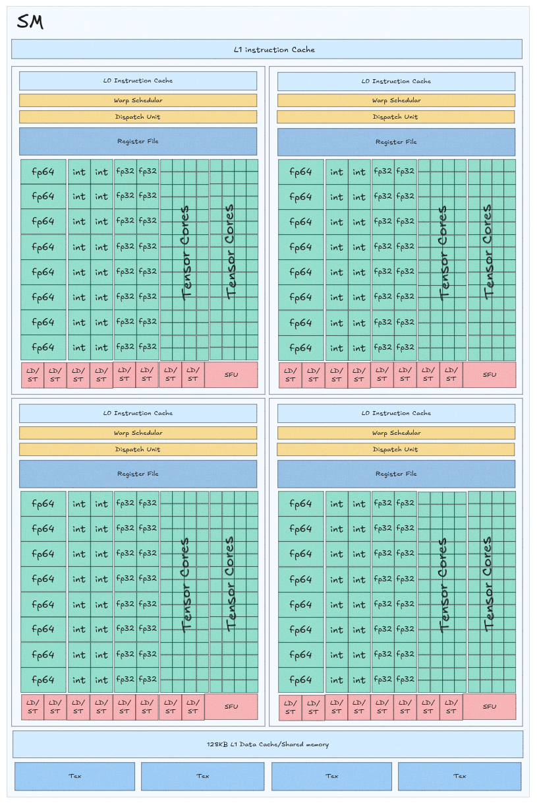


**L2 Cache**: one large cache shared by all SMs. It sits between the compute units and main memory, so data reuse across SMs avoids trips to HBM. It provides 6MB of storage capacity. 

**Memory controllers**: they move data between the L2/SMs and the HBM2 memory. 

**HBM2**: the GPU's main high-bandwidth memory, which holds model weights and the KV cache. There are in total 4 stacks of HBM2 delivering 900GB/s of bandwidth. It provides 16 or 32 GB of VRAM. H100 use HBM3. 

**High-speed hub + NVLink**: the hub connects the chip to 6 NVLink ports, whch provide fast GPU-to-GPU communication, must faster than PCIe(Peripheral Component Interconnect Express). This is what multi-GPU tensor parallelism relies on.
 
Outside the SMs, a GPC also shares things like the raster engine(graphics) and connects to the L2 cache and HBM/GDDR memory at the chip level. 


### Software Side: thread > block > grid 
- **Thread**: one copy of your kernel code, with its own registers and its own ID. 
- **Thread block**: a group of threads(up to 1024). guarantees: run on one SM, all threads at the same time, can share shared memory, can sync with `__syncthreads()`. 
- **Grid**: all blocks of one kernel launch. 
- **Thread block cluster**: a group of blocks placed on the same GPC. They can use other's shared memory(distributed shared memory). 


#### Warps: 
- the hardware split every block into warps of 32 consecutive threads. The warp size is fixed. 
- Block of 256 threads = 8 warps. 
- Block of 100 threads = 4 warps. The last warp has only 4 real threads, the other 28 slots are wasted. Use block sizes that are multiples of 32. 


All 32 threads of a warp run the same instruction at the same time, each on its own data. Its called SIMT(Single Instruction, Multiple Threads). You write normal scalar code like `a[i] + b[i]`. The hardware groups threads into warps for you. With CPU SIMD ou must write vector code yourself. 

One control unit serves 32 cores, so the chip spends less area on control and more on compute. 

### Memory Hierarchy 
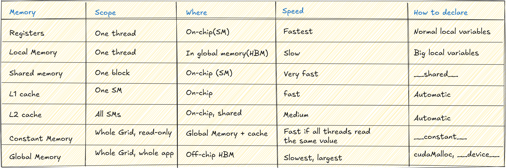

Each level closer to SM is faster and smaller. Moving data costs time and energy. Register access costs at least 10x less energy than global memory access, and needs fewer instructions. 

### On Chip and Outer Chip Interconnects
Inside the GPU, SMs reach memory through a crossbar to the L2 cache slices, which connect to memory controllers and HBM stacks. This spreads traffic over many channels and gives 3.35 TB/s on H100 SXM. Many SMs hitting the same L2 slice compete at the crossbar, so access patterns matter.


Inside a DGX H100 node, 8 GPUs connect through NVSwitch using NVLink 4.0, with 900 GB/s per GPU (total, both directions). Any GPU can reach any other at full speed, so tensor parallelism stays inside a node. PCIe Gen5 (about 128 GB/s) connects the GPUs to the host CPUs and NICs, not GPU to GPU.


For more indepth dive: 
- [Model GPU Glossary][https://modal.com/gpu-glossary]
- First few chapters of the book, Programming Massively Parllallel Processors 
- [H100 GPU Architecture][https://developer.nvidia.com/blog/nvidia-hopper-architecture-in-depth/]

<br/>

## Day 2: CUDA Basics 
Before 2006, GPUs were used mostly for graphics and gamings. Some researchers used graphics shader langauges for general math, but they had to rewrite their problem as a graphics problem. It was hard. In 2006, NVIDIA introduced CUDA (Compute Unified Device Architecture) with the G80 GPU. The first public release came in 2007. CUDA lets you write GPU programs in C/C++. 

There are also other options like OpenCL, AMD ROCm/HIP, Triton etc, but today most AI software runs on CUDA. PyTorch calls CUDA kernels underneath. 

### Data Parallelism 
GPUs are massively parallel data processors. The same operation is applied to many pieces of data, and each piece is independent. 

**For example**: converting a pixel to gray (`L = 0.299r + 0.587g + 0.114b`, one pixel doesn't need other pixels), adding two vectors, one output element of a matrix multiply. 

GPUs are built for data parallelism. CUDA is the way to express it. 


### Host and Device 
- Host: CPU and system RAM. 
- Device: GPU and its own memory(HBM/GDDR).
- Kernel: a function that runs on the device, many times in parallel. 
- A CUDA program is normal C++ with some device code added. Host code runs first, serially. When it calls a kernel, the GPU starts many threads. All threads of one launch form a grid. 
- All threads run the same code, and each uses its own index to choose its data. This is called SPMD(Single Program, Multiple Data). 
- A kernel launch is asynchronuous the host continuous right after the launch and does not wait. 


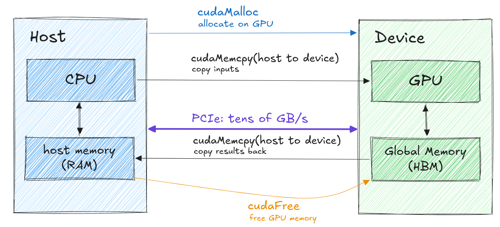

### Some Common Keywords 


### Thread, Blocks and Global Index 
- A grid is an array of blocks. Each block is an array of threads. All blocks have the same size, up to 1024 threads per block. 
- There are some built-in variables inside a kernel: 
 - `threadIdx.x`: thread number inside its block(starts at 0). 
 - `blockIdx.x`: block number inside a grid. 
 - `blockDim.x`: threads per block. 
- Blocks and threads can also be 2D or 3D (add `threadIdx.y, blockIdx.y, blockDim.y` for 2D. Similarly .z for 3D.). For vectors, 1D is enough. 

In CUDA, x is the horizontal direction (columns), and y is the vertical direction (rows). Unlike a math graph, y increases downward: row 0 is at the top. Counting starts at 0, so thread (1,2) means column 1, row 2.


- For the highlighted thread: `col = 2 * 4 + 1 = 9`, `row = 1 * 4 + 2 = 6`. It handles position (9, 6) in a 12 x 8 area.
- In a row-major matrix, this position is the element at `row * width + col`:


Global index of thread will: 
```cpp
int x = blockIdx.x * blockDim.x + threadIdx.x;
int y = blockIdx.y * blockDim.y + threadIdx.y; 
```


This variable `x` is private to each thread (it lives in a register). The loop of the CPU version disappears: each thread is one loop iteration. 

#### Boundary Check and number of blocks 
```cpp
if (row < height && col < width) {
    C[row * width + col] = A[row * width + col] + B[row * width + col];
}
```

The `if` is the 2D boundary check. It is needed when the matrix size is not a multiple of the block size.

#### How the GPU manages the grid 
- **Blocks go to SMs.** Each of the 6 blocks is given to an SM. An SM can hold several blocks, and blocks can run in any order. All threads of one block stay on the same SM.
- **Blocks are split into warps.** The hardware flattens the 2D block into one line of thread numbers(remember, warps are formed inside blocks, not across grid), with x changing fastest, then y using: 

```
linear id = threadIdx.y * blockDim.x + threadIdx.x
```

Then every 32 consecutive threads of the block form one warp. 0 to 31 form the first, 32 to 63 the second one and so on. 

The block has 4 x 4 = 16 threads. Thread (1,2) has linear id `2 * 4 + 1 = 9`, so it is in warp 0, lane 9. 16 threads is less than one warp (32), so **16 lanes of that warp are empty and wasted**. Resources are underutilized here, which is the best way to do it. The small block is only for drawing.

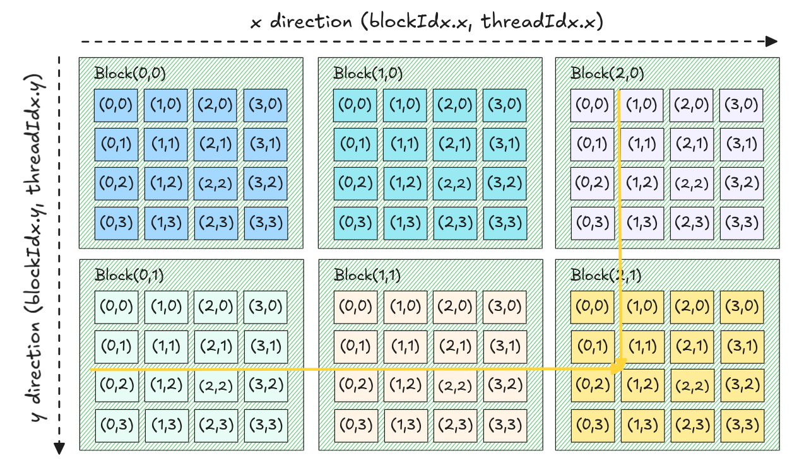
So here there are 6 warps. 

- **In real code:** use block sizes that are a multiple of 32, for example 16 x 16 = 256 threads = 8 warps. In a 16 x 16 block, warp 0 covers rows 0 and 1, warp 1 covers rows 2 and 3, and so on.

- **Why x changes fastest:** the 32 threads of a warp then have consecutive `col` values. They read consecutive addresses in a row-major matrix, and the hardware can merge these reads into few memory transactions (coalescing).


### Vector Addition Kernel Code 
Will end the day with understanding and coding of vector additional kernel. Vectors are 1 dimension array or list. So we will start with this: 

```cpp
__global__ void vecAddKernel(const float* A, const float* B, float* C, int n) {
    int i = blockIdx.x * blockDim.x + threadIdx.x;
    if (i < n) {
        C[i] = A[i] + B[i];
    }
}
```

- `__global__`: it runs on the CPU, launched from the CPU
- `A, B, C`: GPU addresses of the arrays. C is the array in which we will store the output. `n` is the size. 
- `i` is the thread's own element number. 
- `if(i < n)`: skip extra threads that have no elements. Each thread does one addition for now. 

Now to run this from the host side we use write some code: 
```cpp
float *A_d, *B_d, *C_d;
size_t size = n * sizeof(float);

cudaMalloc((void**)&A_d, size);//allocate on GPU
cudaMalloc((void**)&B_d, size);
cudaMalloc((void**)&C_d, size);

cudaMemcpy(A_d, A_h, size, cudaMemcpyHostToDevice);//CPU->GPU
cudaMemcpy(B_d, B_h, size, cudaMemcpyHostToDevice);

vecAddKernel<<<blocks, threads>>>(A_d, B_d, C_d, n); //run on GPU
cudaMemcpy(C_h, C_d, size, cudaMemcpyDeviceToHost); //GPU->CPU

cudaFree(A_d); cudaFree(B_d); cudaFree(C_d); //free GPU space
```

- `cudaMalloc`: allocates GPU memory and stores the address in A_d.
- `cudaMemcpy(dst, src, bytes, direction)`: copies data between CPU and GPU.
- `<<<blocks, threads>>>`: how many blocks, and how many threads per block.
- `blocks = (n + threads - 1) / threads`: n divided by threads, rounded up.
- `cudaFree`: gives the GPU memory back.

Today we covered the fundamental model of CUDA, how threads, blocks, grid, warp work. Tomorrow we will move toward naive version of matrix multiplication and more indepth of 2d grids. 


## Day 3: Matrix Multiplication 
A 2D matrix is stored as a 1D array. C, C++ and CUDA use row-major order: the elements of row 0 first, then row 1, and so on. Opposite to this we have column-major order, first the first column, then second and so on. Fortran, MATLAB, R, Pandas, OpenGL use column-by-column in contiguous memory. 


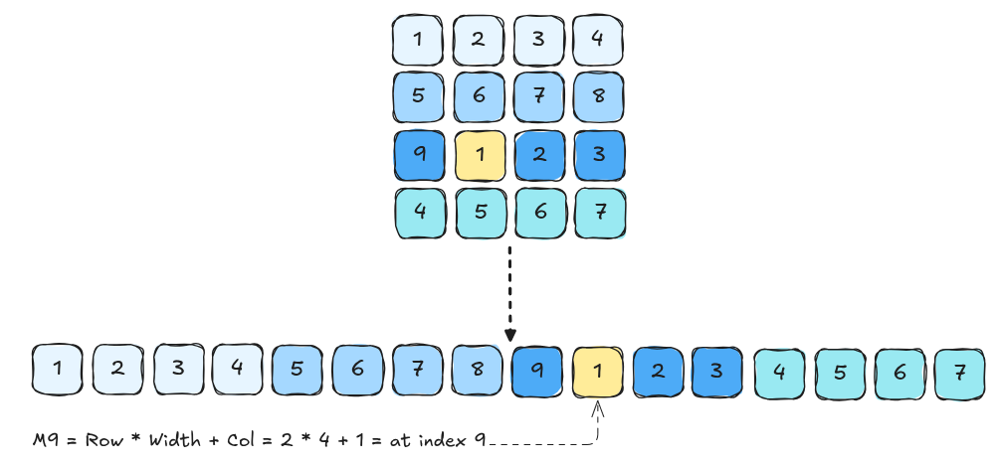

For 3D: we have `index = plane * (Width * Height) + row * Width + col`

Now we will come towards matmul. In matmul we get one element in the output matrix from the dot product of one matrix row and second matrix column. For example: 

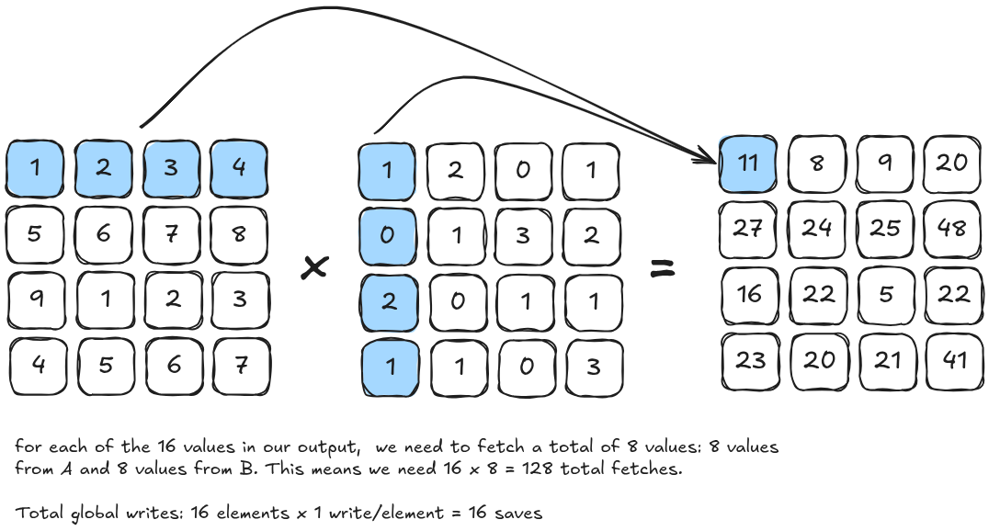

### Naive matmul kernel 
```cpp
// M, N are the input matrices and P is the output
__global__ void MatrixMulKernel(const float* M, const float* N, float* P, int Width){
    int row = blockIdx.y * blockDim.y + threadIdx.y; 
    int col = blockIdx.x * blockDim.x + threadIdx.x; 

    if (row < Width && col < Width){ //boundary check for square matrix
        float Pvalue = 0.0f; 
        for (int k = 0; k < Width; ++k){
            Pvalue += M[row * Width + k] * N[k * Width + col];
        }

        P[row * Width + col] = Pvalue; //one write
    }
}
```

- `row * Width`: jumps to the start of the row, and `+k` steps right inside that row as k grows. 
- If you look, the movement is different in second matrix. `col` selects the column and `k + Width` jumps down one whole row per step of k. 


### Global memory reads and writes (naive kernel)

W = Width (matrices are W x W). Counts are in elements (1 float = 4 bytes).

| | Per thread (one output) | Whole kernel |
|---|---:|---:|
| Reads from M | W | W x W x W = W³ |
| Reads from N | W | W³ |
| **Total reads** | **2W** | **2 x W³** |
| **Writes to P** | **1** | **W²** |
| FLOPs | 2W | 2 x W³ |

Example with W = 4: 16 threads x 8 reads = **128 reads**, **16 writes**.

<br/>

### Bigger sizes

| W | Global reads | Reads in bytes | Writes | Minimum possible reads (each element once) |
|---:|---:|---:|---:|---:|
| 4 | 128 | 512 B | 16 | 32 |
| 1024 | 2,147,483,648 | 8.6 GB | 1,048,576 | 2,097,152 |
| 2048 | 17,179,869,184 | 68.7 GB | 4,194,304 | 8,388,608 |

<br/>
Every element of M and N is read W times, once for each output that needs it. This repeated reading is the waste, which tiling solved(coming topic). 

- Arithmatic intensity (no cache): 2W³ FLOPs/(2W³ x 4 bytes) = 0.25 FLOP per byte. 
- The H100 needs about 300 FLOPs per byte to be compute-bound. The naive kernel is far on the memory-bound side. 


## Day 4: Memory access: Coalescing 
The goal for today is to see with measurements that the way threads touch memory can change speed by 4x to 8x. We use simple copy kernels.

- Global memory is DRAM(HBM or GDDR). Reading one cell is slow. To compensate, DRAM returns a burst: a block of consecutive bytes for each access. Bytes of the burst that you use are cheap. Bytes you don't use are wasted. 

- The GPU caches work the same way. Data moves in cache lines of 128 bytes and each line has four 32-byte sectors. A memory transaction fetche whole sectors. 

- So the speed depends on how many sectors a warp must fetch, not on how many bytes it needs. 

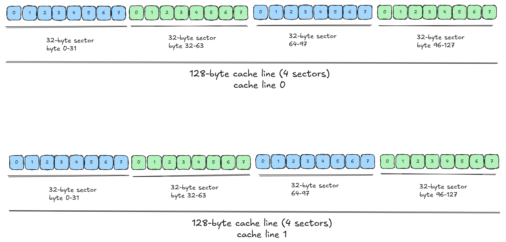

There are three types of global memory access: 

1. **Contiguous access(Coalesced)**: consecutive threads access consecutive memory locations. The GPU combines these reqeusts into fewer memory transactions. 

2. **Stried Access(Uncoalesced)**: consecutive threads access memory locations separated by a fixed distance(stride). This requires more memory transactions and wastes bandwidth. 

3. **Random access(scattered):** threads access unrelated memory locaitons with no predictable pattern. The GPU may need separate memory transactions for each access, resulting in poort memory efficieny. 


### Coalescing

A warp has 32 threads, and they all load at the same moment. The hardware checks which sectors these 32 loads need.

- **Coalesced:** the 32 threads read 32 neighbouring floats. They need 128 bytes in total, which is 4 sectors. All the fetched data is used.

- **Not coalesced:** the threads read floats that are far apart. Each thread needs a different sector. For example, the GPU fetches 32 sectors (1024 bytes) to use 128 bytes(useful bytes/fetched bytes = 128/1024 = 12.5%). **The other 87.5% of the fetched data is wasted.** 

Fewer sectors per warp = faster load.

### How the stride changes it

Stride = how many floats apart neighbouring threads read. Thread t reads element `t * stride`.

| Stride | Sectors fetched per warp | bytes spanned by the warp | Useful data |
|---:|---:|---:| ------:|
| 1 (best) | 4 | 128 | 128/ 128 = 100% |
| 2 | 8 | 256 | 128/256 = 50% |
| 4 | 16 | 512 | 128/512 = 25% |
| 8 or more | 32 | 1024 | 128/1024 = 12.5% |

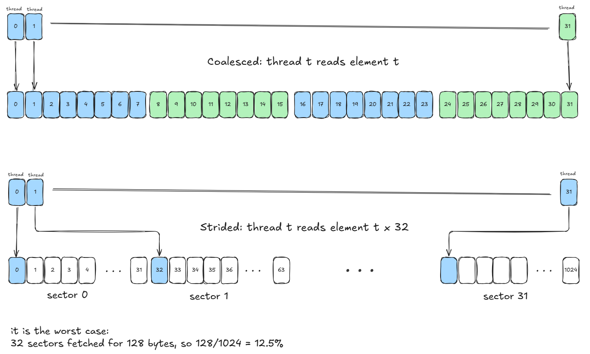


From stride 8, every thread already uses its own sector (32 threads = 32 sectors). So it cannot get worse than 12.5%.

<br/>

If the 32 floats start in the middle of a sector, the warp touches 5 sectors instead of 4. This is 80%(128/160) useful. The effect is small on modern GPUs, because the cache keeps the neighbouring sector for the next warp.

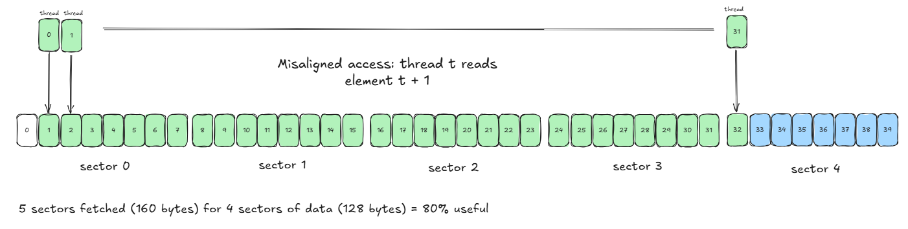


Writes follow the same rule. A store that changes only part of a sector can be even worse than a load. With ECC on, the GPU must read the sector, change it, and write it back.


The rule is to make `threadIdx.x` move along the contiguous index, so that neighbouring threads access neighbouring floats.


### How to Get Coalesced Memory Access 
The rule is to map consecutive threads to consecutive memory locations. 

- The threads of a warp have consecutive `threadIdx.x`. So `threadIdx.x` must move along the contiguous index of the array. 

- Row-major matrix: element (row, col) is at `row * Width + col`. The column is contiguous so col must come from threadIdx.x. Moving across columns increases the memory index by one. 

- `N[k * Width + col]` is coalesced. `M[row * Width + k]` has the same address for all threads of a warp. (one value from the M is broadcasted). 

- If threads walk down a column (`A[col * Width + row]`), their addresses are `Width` apart. Uncoalesced. 

- Use structure of arrays (one array per field) instead of array of structures when each thread reads the same field of different items. 

### Shared Memory 
Shared memory has 32 banks, each 4 bytes wide. Word number i is in bank i % 32. If the 32 threads of a warp use 32 different banks, all are served in one step. If several threads use different addresses in the same bank, that is a bank conflict. The accesses are served serially: one after another. If several threads read the same address, it is a braodcast. No conflict, like in the third point in the previous section. 

Tomorrow we will cover some more memory optimizations. 

## Day 5: More on GPU Memory  
### Occupancy
Registers are very small, extremely fast storage locations physically located inside the SM's execution hardware.

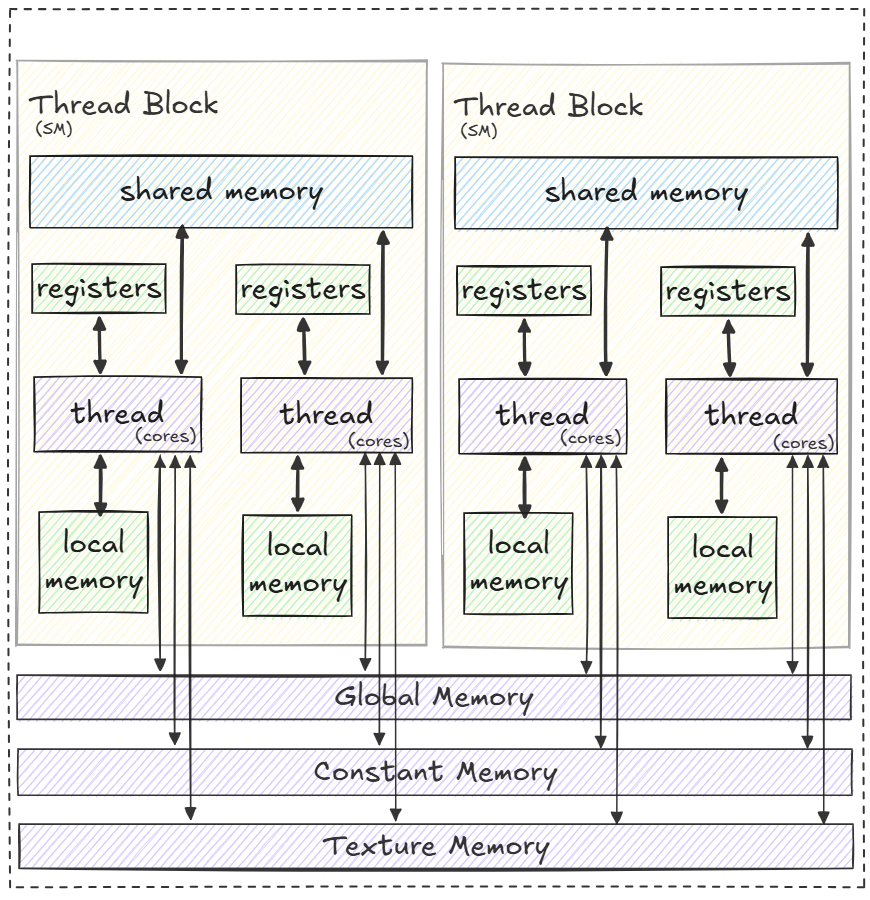

Each thread has its own logical register values. Other threads can't directly access that thread's registers. Registers hold intermediate values, pointers, loop counters and calculations. The compiler decides how many registers a thread needs. 

An SM has a finite register file. If too many registers are required by simultaniously resident threads, fewer threads can reside on that SM. 

- **Active warps per SM** = active thread blocks per SM * active warps per block
- **Active threads per SM** = active thread blocks per SM * ThreadsPerBlock 

- **Active thread blocks per SM** = Min(warp-based-limit, registers-based limit, shared-memory-based-limit)


What happens while the warp waits for data? The SM schedular can select another eligible warp and execute its instructions. This is called latency hiding. 

The purpose of occupancy is to provide enough resident warps to help hide execution latency.

**A kernel with 50% occupancy can outperform a kernel with 100% occupancy if it has better instruction-level parallelism, less redundant work, or better memory behavior.**

### Register Pressure 
Describes the demand placed on the available register resources by a kernel's live values. 

If many values must remain alive at the same time, the compiler needs more registers per thread. That increases register pressure. 

More resources consumed per thread can reduce the number of resident threads and warps.

### Register Spilling 
Imagine the compiler wants to keep 100 values available for a thread, but the compiler or hardware allocation constraints make it unable to keep all those values in registers.

It may place some values in local memory. This is called register spilling. register spilling can cause additional memory traffic and reduce performance.


## Day 6: Memory Optimizations 
### Vectorized Memory Access 
We have studied that coalescing groups memory requests from multiple threads into one big transaction. **Vectorization** lets a single thread load or store multiple consecutive values in one wide operation. 

**How cuda implements it**: 
- a standard float is 32 bits(4 bytes). 
- a float4 is a built-in CUDA type holding four consecutive float values: 128 bits (16 bytes). 
- Instead of executing four separate 32-bit load instructions, the compiler generates one 128-bit load instruction. 

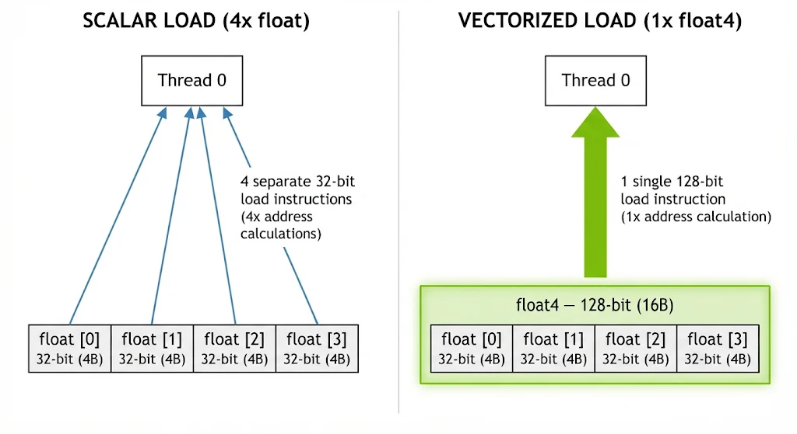

**Why it improves performance**: 
1. Fewer Instructions: Cuts memory load/store instructions by up to 4x, freeing up the GPU's instruction scheduler.

2. Lower Address Overhead: The GPU calculates one base memory address instead of four separate addresses

3. Better Bandwidth Utilization: Moves larger chunks of data per clock cycle from Global Memory to registers.


### Thread Coarsening 
Each thread processes multiple data elements sequentially instead of a strict 1-to-1 mapping between threads and data elements. Instead of launching 1024 threads for 1024 elements (where thread `i` handles element `i`), you launch fewer threads (eg. 256) and have each thread run a small loop to process multiple elements (eg. 4 elements each). 

**Standard 1:1 Mapping**: 

```
int i = blockIdx.x * blockDim.x + threadIdx.x;
B[i] = A[i] * 2;
```

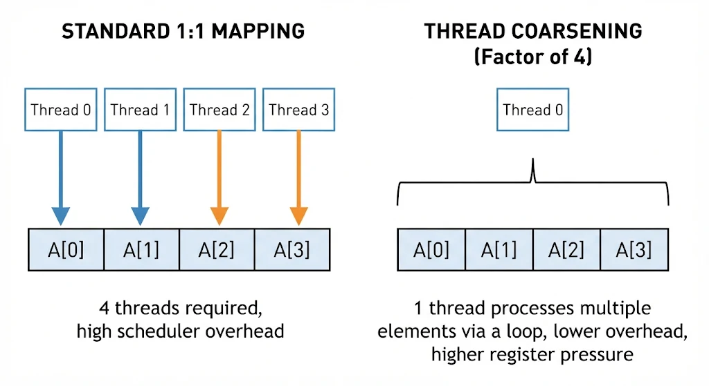

**Coarsed Mapping**: 
```cpp 
int tid = blockIdx.x * blockDim.x + threadIdx.x;
int unroll_factor = 4;
int start_idx = tid * unroll_factor;

#pragma unroll
for (int j = 0; j < unroll_factor; j++) {
    B[start_idx + j] = A[start_idx + j] * 2;
}
```

**Why it improve performance**: 
1. Reduced Thread Overhead: Cuts down the total number of threads managed by the GPU schedular, lowering control flow and indexing overhead. 

2. Increased instruction-level parallelism(ILP): By loading multiple values inside the same thread, the compiler can overlap independent instructions and hide execution latency. 

3. If the same element or neighboring elements are accessed mutliple times within the thread's local loop, they can stay in fast registers instead of being refetched from memory. 

**But there is a tradeoff**: 
Because a single threads handles multiple elements simulteneously. It needs more registers to store those intermediate values. If register usage exceeds the hardware limit, the GPU resorts to register spilling (writing data to slow local memory), which can severly hurt performance and reduce active warp occupancy. 


### Day 7: Tiled Matrix Multiplication 
In day 3, we saw that naive matmul is severely memory-bound. Every element of the M and N matrces is read W times from slow HBM, giving an arithmatic intensity of just 0.25 FLOP/byte. 

The core idea of tiling is, instead of computing an entire dot product directly from **global memory**, we break the matrices into smaller sub-matrices (tiles) of size **T x T** that fit into fast **on-chip shared memory**. 

- Threads in a block cooperatively load one tile of M and one tile of N from global memory into shared memory. 

- Every thread in that block then reuses those loaded values T times to compute a partial dot product before moving to the next pair of tiles. 

**Working**: 

First we need to see exactly how much memory bandwidth we waste in a standard, naive matmul. Let's look at the 2 x 2 quadrant of outpuer matrix P, computed by four threads: 
- `thread(0,0)` for **P0,0**
- `thread(0,1)` for **P0,1**
- `thread(1,0)` for **P1,0**
- `thread(1,1)` for **P1,1**

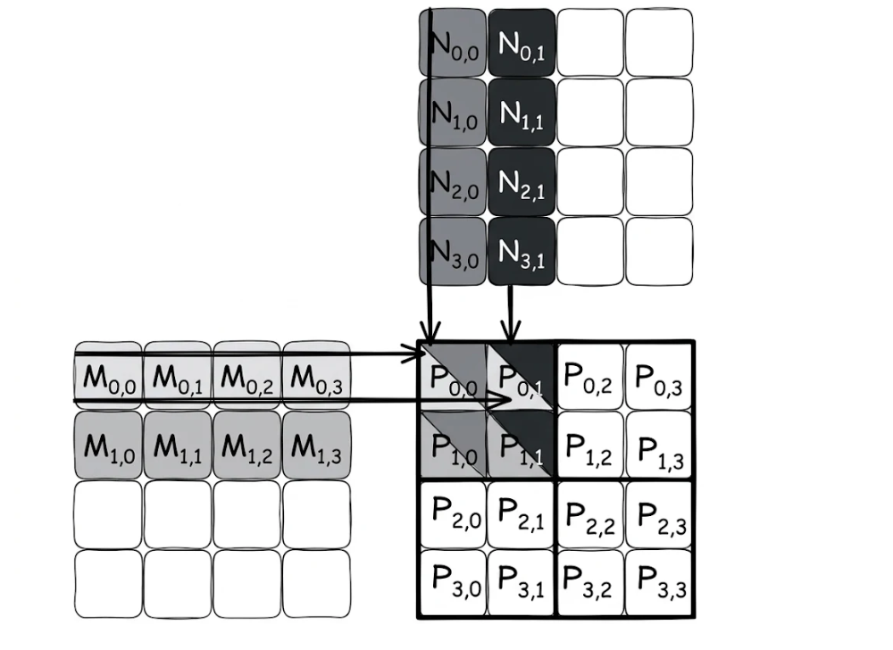

Every thread in a naive setup runs its own loop, fetching eleemnts directly from slow Global Memory over and over, with zero coordinations: 

In first iteration 
- `thread(0,0)` fetches **M0,0** and **N0,0** to compute the first part of **P0,0** (in our tiled matmul phase 1, it is the 1).

- `thread(0,1)` fetches the exact same **M0,0** and new **N0,1**. This means **M0,0** was fetched twice. 

- `thread(1,0)` fetches **M1,0** and the exact same **N0,0** (M1,0 * N0,0). This means **N0,0** was fetched twice.

- `thread(1,1)` fetches **M1,0** and the exact same **N0,1** (M1,0 * N0,1).
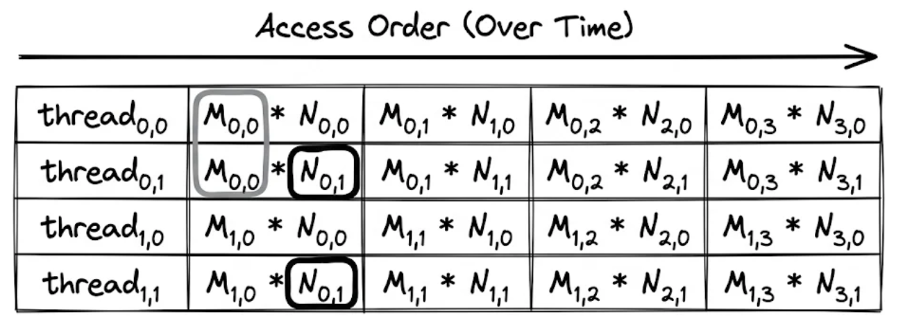

In a $4 \times 4$ matrix every single element of Matrix M and Matrix N is fetched 4 times by different threads. So what we are doing in naive kernel is: 

Instead of loading an element into fast, on-chip SRAM once and sharing it, we load it and use it in a thread and throw it away, only for a neighboring thread to immediately ask Global Memory for that exact same piece of data. 

With $4 \times 4$ matrices, the 16 threads make a staggering 128 global memory reads to compute 16 outputs, despite the inputs only having 32 total elements. This redundant memory traffic quickly saturates the GPU's memory bandwidth, leaving massive compute resources sitting idle while waiting on data.

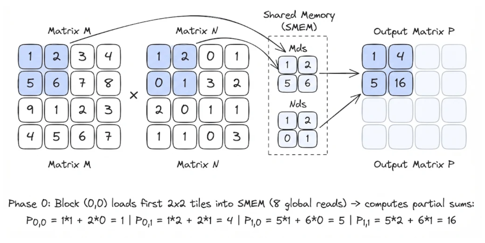
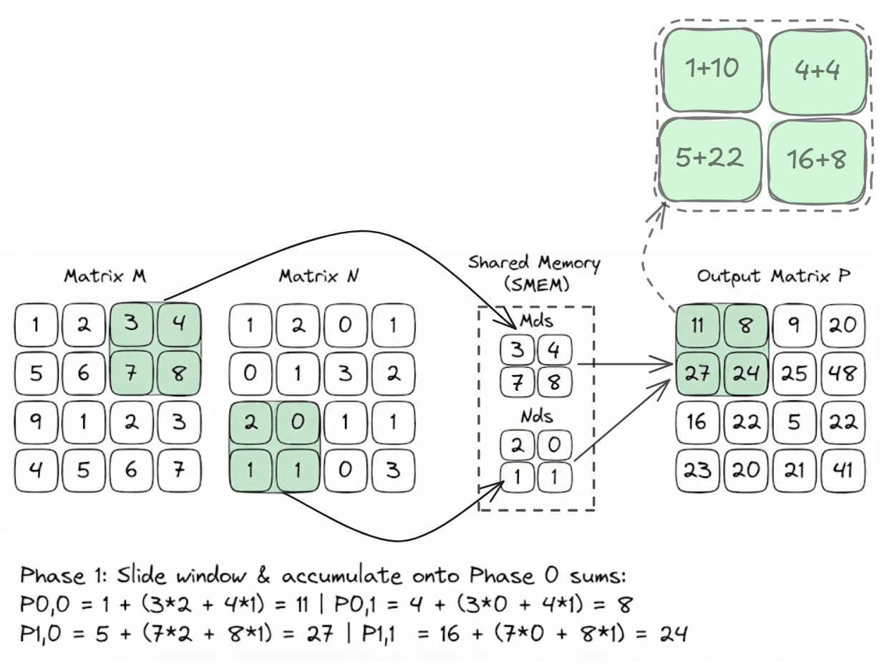

Do exactly same for the other quandrants or tileds of the output matrix. Go back to the naive matmul day and check the output values are same for both ways of matmul, the later one just efficient usage of memory. 

### How efficient is Tiling: 
- In a $4 \times 4$ matrix ($W=4$), the naive kernel uses 16 independent threads that each read an entire row of **M** (4 elements) and an entire column of **N** (4 elements) directly from Global Memory, resulting in **16 x (4+4) = 128** global reads. 

- With **2 x 2** tiling (T=2), the output is divided into 4 thread blocks (4 threads per block) that execute across 4/2 = 2 phases; 
  - in each phase, the entire 4 threads cooperatively load only one **2x2** tile of M (4 reads) and one **2x2** tile of N(4 reads) into shared memory and reuse each element T = 2 times locally. 
  - meaning each block performs 2 phases x (4 + 4) = 16 global reads and all 4 blocks combined perform 4 x 16 = 64 reads. ($\frac{2W^3}{T} = \frac{2 \times 4^3}{2} = 64$, cuts traffic by factor of T = 2). 

- Meanwhile global writes remain unchanged at $\mathbf{16}$ ($W^2$) in both approaches because each of the 16 threads still computes one final output element in its private register and writes it once to Global Memory P at the end. 

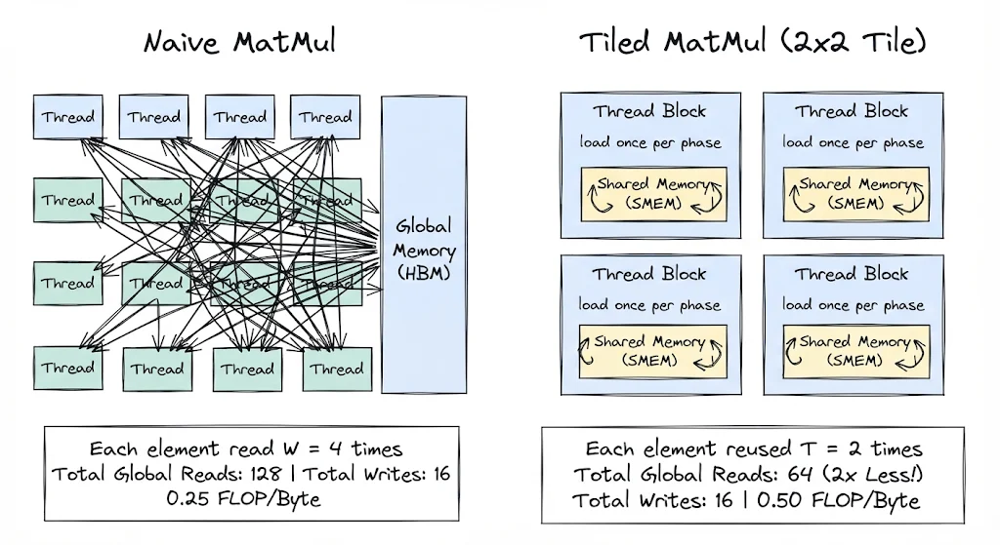
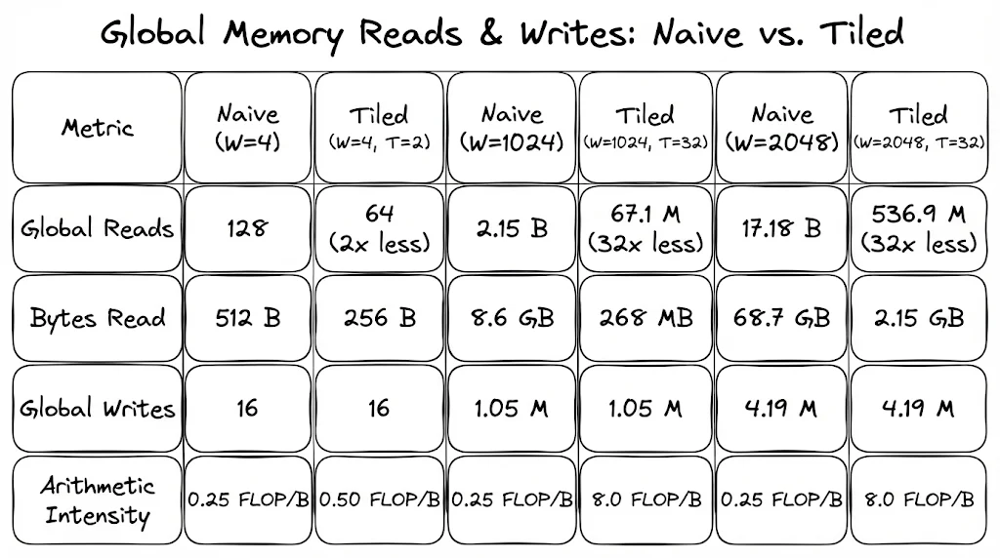

### Tiled Matmul kernel 
```cpp
#define TILE_WIDTH 2

__global__ void matMulKernel(float* M, float* N, float* P, int Width){ 
    //Width: of the matrix, here 4

    // one tile-worth of M and one tile-worth of N, 
    // shared by every thread in the block(scope). 
    __shared__ float Mds[TILE_WIDTH][TILE_WIDTH];
    __shared__ float Nds[TILE_WIDTH][TILE_WIDTH];

    int bx = blockIdx.x; //block column position
    int by = blockIdx.y; //block row position, 

    //every thread in the same block has the same bx and by. 

    int tx = threadIdx.x; //column position of thread within the block. 
    int ty = threadIdx.y; //row position within the block. 

    int Row = by * TILE_WIDTH + ty; // global row index of the thread
    int Col = bx * TILE_WIDTH + tx; // global column index of the thread

    float Pvalue = 0; 
    //one iteration per tile. 
    for (int ph = 0; ph < Width/TILE_WIDTH; ++ph){
        
        Mds[ty][tx] = M[Row*Width + ph*TILE_WIDTH + tx];
        //Mds[1][0] = M[1*4 + 0*2 + 0] = M[4] = M1,0

        Nds[ty][tx] = N[(ph*TILE_WIDTH + ty)*Width + Col];
        //Nds[0][1] = N[(0*2 + 0)*4 + 1] = N[1] = N0,1

        __syncthreads();
        //read-after-write dependence(true dependence): threads must wait until 
        // for data to be written to the proper place by other threads 
        // before they try to read it. 

        for (int k = 0; k < TILE_WIDTH; ++k) {
            Pvalue += Mds[ty][k] * Nds[k][tx];
        }
        __syncthreads();
        // write-after-read dependence(false dependence): thread 
        // must wait for the data to be read by all threads that 
        // need it before overwriting it. 
    }

    //global, the full complete value is writen here, not the half dot product value. 
    P[Row*Width + Col] = Pvalue; 
}
```


## Day 8: Boundary Checks in Tiled MatMul
In our matmuls, both naive and tiled, we assumed square matrices whose width is an exact multiple of `TILE_WIDTH`. In real workload, and especially when testing non-multiples like `Width=3` with `TILE_WIDTH=2`, two things happen: 

- For `W=4 and TILE_WIDTH=2`phases are `4/2=2`. In `3x3` case, normal integer division truncates (`3/2=1`), which skips the final column/row in `3x3` matrix. To cover the tail elements, the phase count is `(Width + TILE_WIDTH - 1) / TILE_WIDTH` which gives 2 for this configuration. 

- Launching enough `2x2` blocks to cover a `3x3` matrix creates a `4x4` thread grid, leaving extra threads at index `3`.  Guarding global reads with `0.0f` padding and guarding global writes prevents silent row-wraps, out-of-bounds memory reads, and invalid writes. 


### How to Handle Boundary Checks Safely 
Instead of skipping shared-memory writes (which would leave stale or garbage values inside `Mds` or `Nds` for `Pvalue += Mds[ty][k] * Nds[k][tx]`), every thread in the block still participates in the load step and writes 0.0f when its source coordinate is out of bounds. Adding 0.0f during the k loop leaves the partial dot product unchanged without reading invalid global memory.

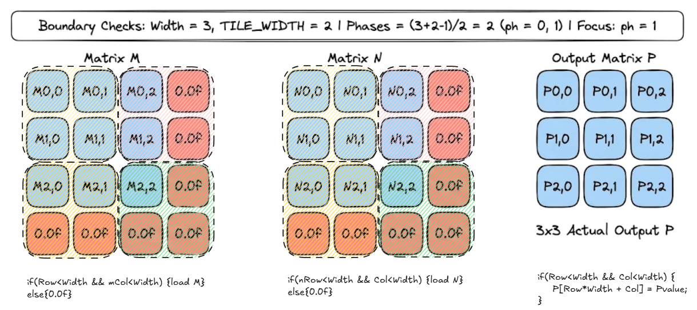

We add three guards here: 
1. Boundary check for M: valid row **(Row < Width)** and valid column **(mCol < Width)**.
    ```cpp
    if (Row < Width && mCol < Width){
        Mds[ty][tx] = M[Row * Width + mCol];
    } else {
        Mds[ty][tx] = 0.0f; 
    }
    ```

2. Boundary check for N: valid row **(mRow < Width)** and valid column **(Col < Width)**
    ```cpp
    if (nRow < Width && Col < Width){
        Mds[ty][tx] = M[nRow * Width + Col];
    } else {
        Mds[ty][tx] = 0.0f; 
    }
    ```

    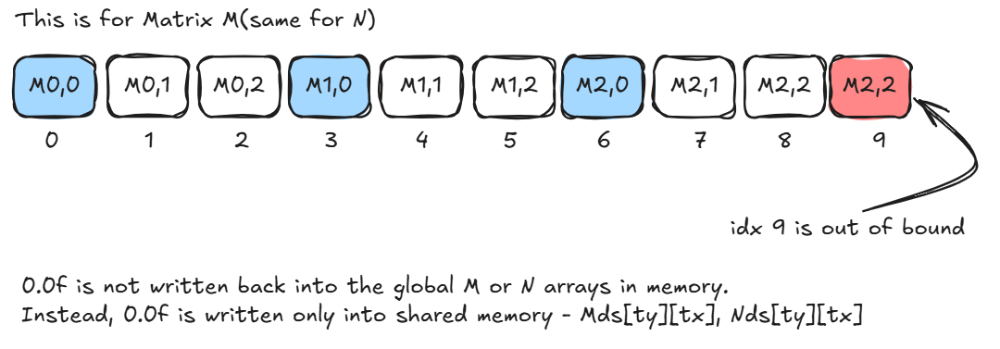

3. Boundary check for P: only valid output coordinates write back to global memory. 
    ```cpp
    if (Row < Width && Col < Width){
        P[Row * Width + Col] = Pvalue; 
    }
    ```

### The Kernel
```cpp
# define TILE_WIDTH 2 

__global__ void matMulKernel(float* M, float* N, float* P, int Width){
    __shared__ float Mds[TILE_WIDTH][TILE_WIDTH];
    __shared__ float Nds[TILE_WIDTH][TILE_WIDTH];

    int bx = blockIdx.x;
    int by = blockIdx.y; 
    
    int tx = threadIdx.x; 
    int ty = threadIdx.y; 

    float Pvalue = 0.0f; 

    // ceiling division ensurs partial tiles
    int numPhases = (Width + TILE_WIDTH - 1) / TILE_WIDTH; 

    for (int ph = 0; ph < numPhases; ++ph){
        int mCol = ph * TILE_WIDTH + tx; 
        int mRow = ph * TILE_WIDTH + ty; 

        if(Row < Width && mCol < Width){
            Mds[ty][tx] = M[Row * Width + mCol];
        } else {
            Mds[ty][tx] = 0.0f; 
        }

        if(nRow < Width && Col < Width){
            Nds[ty][tx] = N[nRow * Width + Col];
        } else {
            Nds[ty][tx] = 0.0f; 
        }

        __syncthreads();

        for (int k = 0; k < TILE_WIDTH; ++k){
            Pvalue += Mds[ty][k] * Nds[k][tx]
        }

        __syncthreads();
    }

    if(Row < Width && Col < Width){
        P[Row * Width + Col] = Pvalue; 
    }
}
```