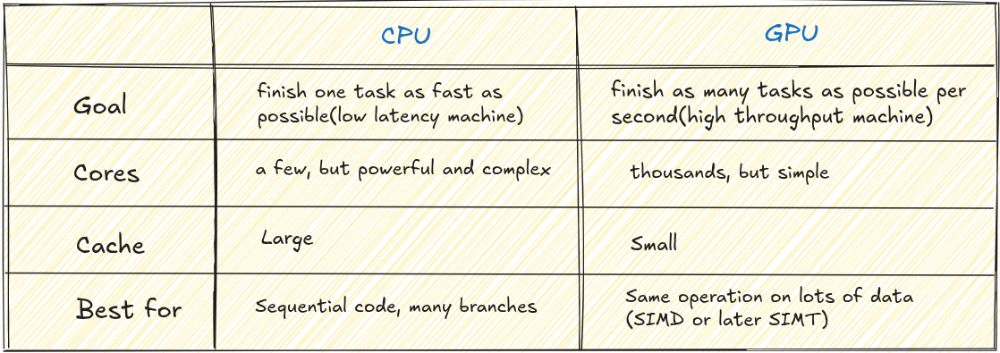
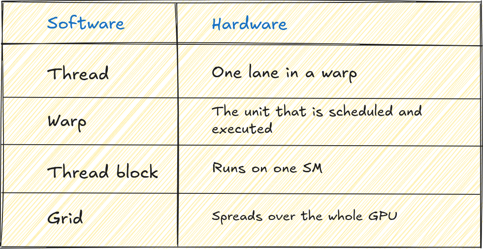
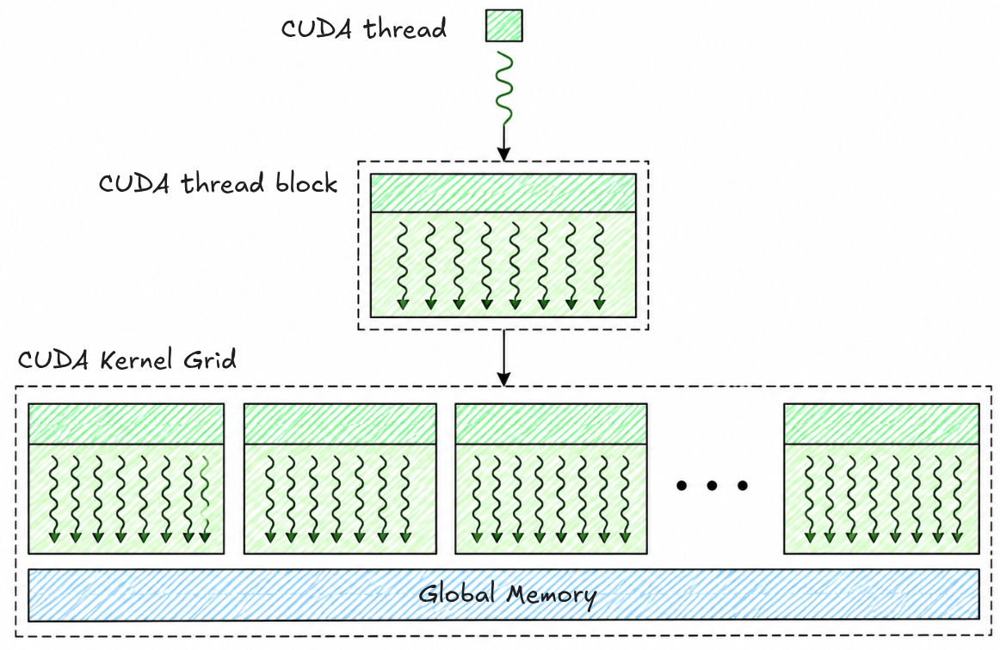
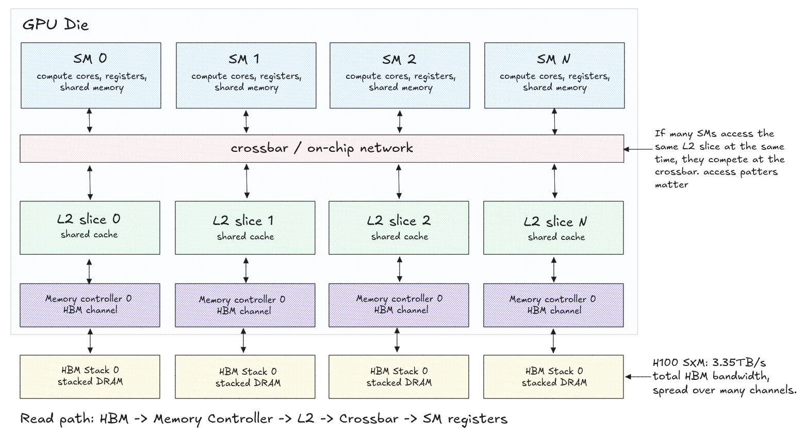
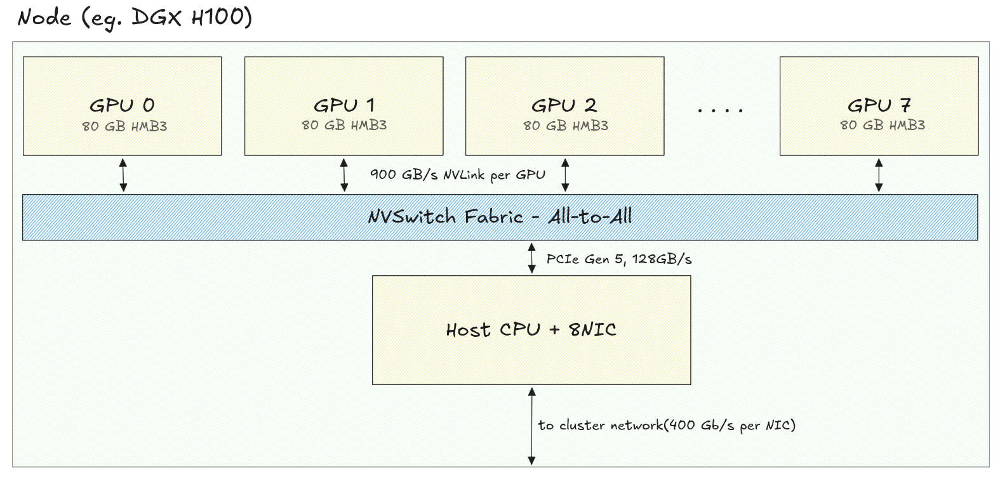
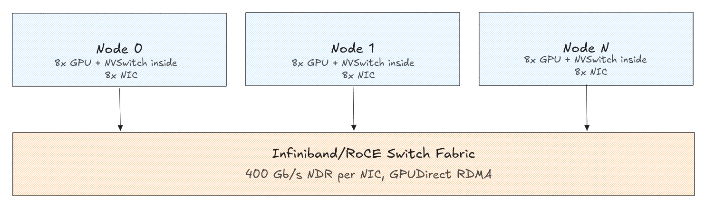

# Inference Engineering In 90 Days
A hands-on, build-in-public journey through LLM inference and infrastructure: from how a single token is generated, to GPU kernels, to serving models at scale in production.

**Notes**: I'm writing it for my own revision and to teach others, so corrections and issues are welcome.

## Day 1: GPU Arachitecture For Inference Engineers 

### Why We Moved from CPUs to GPUs

Until ~2004, extra transistors were used to push clock speeds higher, which made single cores faster. But power rises roughly with the cube of frequency, and chips hit a ~100W power and cooling wall, so clocks stalled while transistor counts kept growing.

The industry pivoted from "one faster core" to "many cores," which only helps when work can be parallelized. GPUs, built for massively parallel graphics, take this idea to the extreme: thousands of simple cores instead of a few complex ones. With CUDA (2006), GPUs became programmable for general computing, and since deep learning is mostly parallel matrix math, they became the default hardware for AI.

### CPUs vs GPUs 

 
CPUs optimize for fast execution of a few threads using big caches, while GPUs optimize for throughput across thousands of threads, spending transistors on computation and hiding memory latency with parallelism.

Most of the transistors in CPUs go to the cache and control units. In GPUs more focus is on processing cores. 

### Hardware Side 
**Note**: most of the images are modified images of the Volta GV100 architecture. 

**PCIe 3.0 Host Interface**: the link between the GPU(device) and the host machine(CPU). Data and command enter here. 

**Giga Thread Engine**: The global schedular. It receives work from the host and hands thread blocks out to the SMs. 

Inside GPU, there are many **GPC(Graphics Processing Cluster)**, work like a mini-GPU. Here are 6 GPCs. Inside each each GPC there are many **TPC(Texture Processing Cluster)**. Each GPC has 7 TPCs. Each TPC contains 2 SMs (one on top, one on the bottom). 

**Streaming Multiprocessors(SMs)** are the real workhorse. There are 84 of them in volta GV100. Each SM contains: 
- CUDA cores(execute FP32/INT32 math)
- Tensor cores: do fast mma(matrix multliply-accumulate)
- Warp schedulars and dispatch units: pick which group of 32 threads(which they called a warp) runs next. 
- Register file: very fast per-thread storage. 
- Shared memory/L2 cache: fast on-chip memory that threads in a block(group of threads) share. 
- Load/Store units and special function units(SFUs): memory access and opeartions like exp, sin, rsqrt etc. 

**L2 Cache**: one large cache shared by all SMs. It sits between the compute units and main memory, so data reuse across SMs avoids trips to HBM. 

**Memory controllers**: they move data between the L2/SMs and the HBM2 memory. 

**HBM2**: the GPU's main high-bandwidth memory, which holds model weights and the KV cache. H100 use HBM3. 

**High-speed hub + NVLink**: the hub connects the chip to 6 NVLink ports, whch provide fast GPU-to-GPU communication, must faster than PCIe. This is what multi-GPU tensor parallelism relies on.
 
Outside the SMs, a GPC also shares things like the raster engine(graphics) and connects to the L2 cache and HBM/GDDR memory at the chip level. 

### Software Side: thread > block > grid 
- **Thread**: one copy of your kernel code, with its own registers and its own ID. 
- **Thread block**: a group of threads(up to 1024). guarantees: run on one SM, all threads at the same time, can share shared memory, can sync with `__syncthreads()`. 
- **Grid**: all blocks of one kernel launch. 
- **Thread block cluster**: a group of blocks placed on the same GPC. They can use other's shared memory(distributed shared memory). 

#### Warps: 
- the hardware split every block into warps of 32 consecutive threads. The warp size is fixed. 
- Block of 256 threads = 8 warps. 
- Block of 100 threads = 4 warps. The last warp has only 4 real threads, the other 28 slots are wasted. Use block sizes that are multiples of 32. 

All 32 threads of a warp run the same instruction at the same time, each on its own data. Its called SIMT(Single Instruction, Multiple Threads). You write normal scalar code like `a[i] + b[i]`. The hardware groups threads into warps for you. With CPU SIMD ou must write vector code yourself. 

One control unit serves 32 cores, so the chip spends less area on control and more on compute. 

### Memory Hierarchy 

Each level closer to SM is faster and smaller. Moving data costs time and energy. Register access costs at least 10x less energy than global memory access, and needs fewer instructions. 

### On Chip and Outer Chip Interconnects
Inside the GPU, SMs reach memory through a crossbar to the L2 cache slices, which connect to memory controllers and HBM stacks. This spreads traffic over many channels and gives 3.35 TB/s on H100 SXM. Many SMs hitting the same L2 slice compete at the crossbar, so access patterns matter.

Inside a DGX H100 node, 8 GPUs connect through NVSwitch using NVLink 4.0, with 900 GB/s per GPU (total, both directions). Any GPU can reach any other at full speed, so tensor parallelism stays inside a node. PCIe Gen5 (about 128 GB/s) connects the GPUs to the host CPUs and NICs, not GPU to GPU.

For more indepth dive, the follow the following resources: 
- [Model GPU Glossary][https://modal.com/gpu-glossary]
- First few chapters of the book, Programming Massively Parllallel Processors 
- [H100 GPU Architecture][https://developer.nvidia.com/blog/nvidia-hopper-architecture-in-depth/]

## Day 2: 