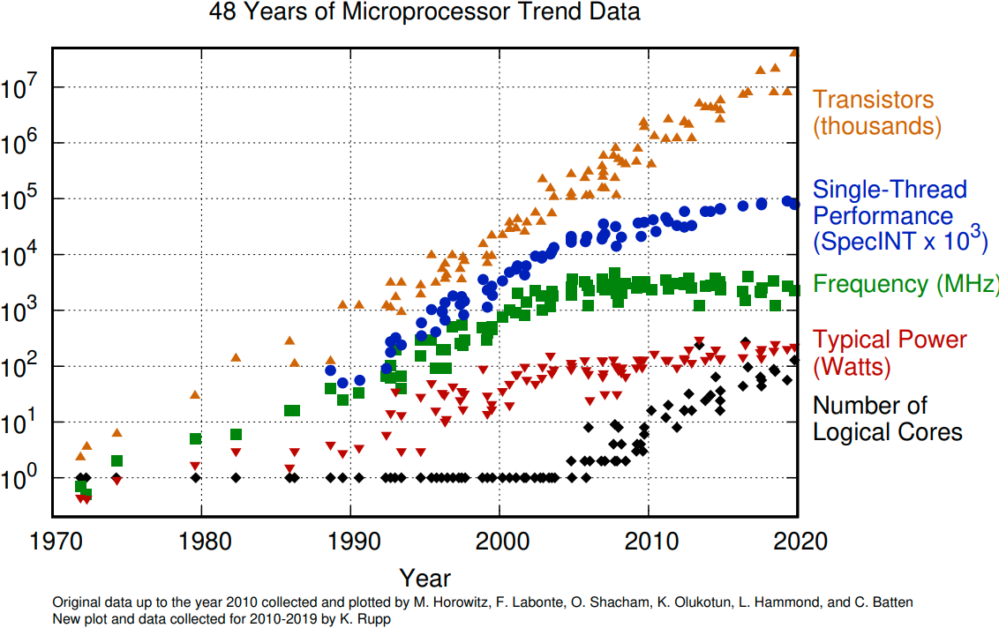
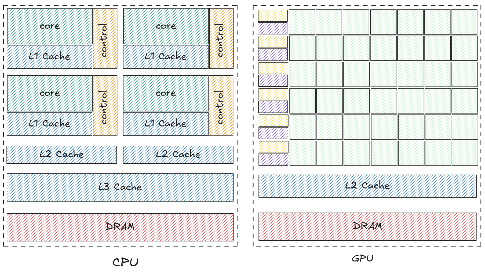
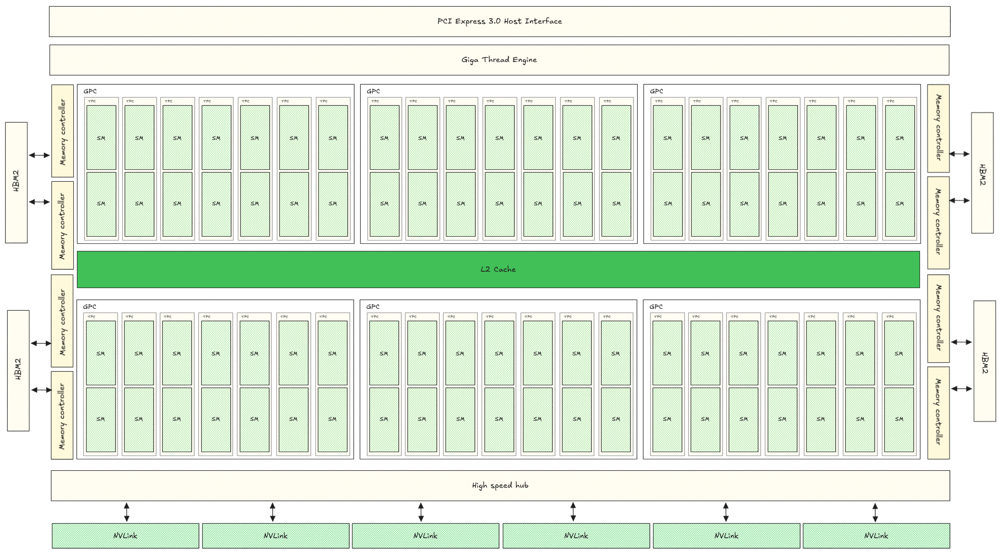
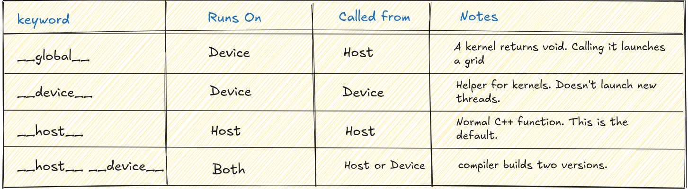
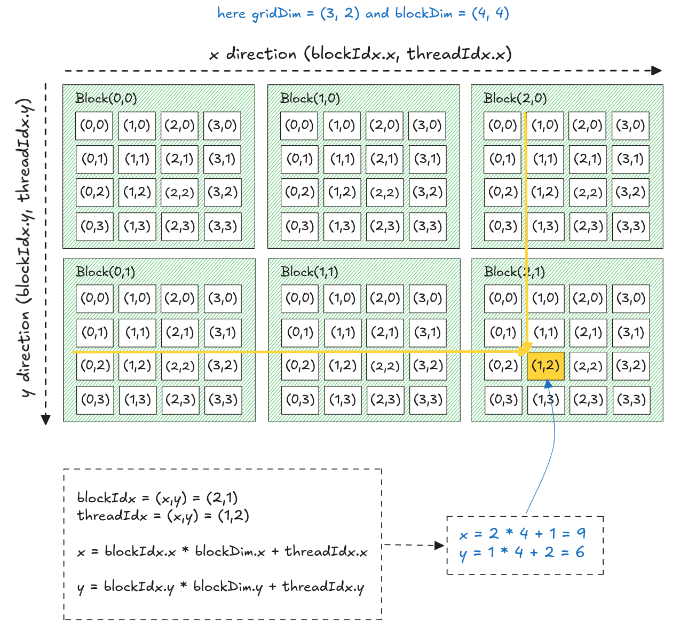

# Inference Engineering In 90 Days
A hands-on, build-in-public journey through LLM inference and infrastructure: from how a single token is generated, to GPU kernels, to serving models at scale in production.

**Note**: I'm writing it for my own revision and documentation purpose. Corrections and issues are welcome.

<br/>

## Day 1: GPU Arachitecture For Inference Engineers 

### Why We Moved from CPUs to GPUs

Until ~2004, extra transistors were used to push clock speeds higher, which made single cores faster. But power rises roughly with the cube of frequency, and chips hit a ~100W power and cooling wall, so clocks stalled while transistor counts kept growing.



*Source: [Source of the Image](https://enccs.github.io/openmp-gpu/gpu-architecture/)*


The industry pivoted from "one faster core" to "many cores," which only helps when work can be parallelized. GPUs, built for massively parallel graphics, take this idea to the extreme: thousands of simple cores instead of a few complex ones. With CUDA (2006), GPUs became programmable for general computing, and since deep learning is mostly parallel matrix math, they became the default hardware for AI.

### CPUs vs GPUs 


<br/>
CPUs optimize for fast execution of a few threads using big caches, while GPUs optimize for throughput across thousands of threads, spending transistors on computation and hiding memory latency with parallelism.

Most of the transistors in CPUs go to the cache and control units. In GPUs more focus is on processing cores. 



### Hardware Side 
**Note**: We will mostly focus on NVIDIA Volta GV100 Architecture



**PCIe 3.0 Host Interface**: the link between the GPU(device) and the host machine(CPU). Data and command enter here. 


**Giga Thread Engine**: The global schedular. It receives work from the host and hands thread blocks out to the SMs. 


Inside GPU, there are many **GPC(Graphics Processing Cluster)**, which work like a mini-GPU. Here are 6 GPCs. Inside each each GPC there are many **TPC(Texture Processing Cluster)**. Each GPC has 7 TPCs. Each TPC contains 2 SMs (one on top, one on the bottom). 


**Streaming Multiprocessors(SMs)** are the real workhorse.Each SM in Volta GV100 is divided into 4 processing blocks. There are 84 SMs inside GV100. NVIDIA disable 4 of them, which improves manufacturing yeild. Inside each SM there are: 
- CUDA cores(64 per SM). Executes FP32.
- INT cores(64 per SM)
- FP64 cores(32 per SM): used heavily in scientific computing and HPC. 
- Tensor cores(8 per SM): do fast mma(matrix multliply-accumulate)
- Warp schedulars and dispatch units: pick which group of 32 threads(which they called a warp) runs next. 
- Register file: very fast per-thread storage. Total of 256KB for all the four blocks of SM combinely(64KB x 4 blocks)
- Shared memory/L2 cache: fast on-chip memory that threads in a block(group of threads) share. It provides 128 KB storage. 
- Load/Store units and special function units(SFUs)(4 per SM): memory access and opeartions like exp, sin, rsqrt etc. 


**L2 Cache**: one large cache shared by all SMs. It sits between the compute units and main memory, so data reuse across SMs avoids trips to HBM. It provides 6MB of storage capacity. 

**Memory controllers**: they move data between the L2/SMs and the HBM2 memory. 

**HBM2**: the GPU's main high-bandwidth memory, which holds model weights and the KV cache. There are in total 4 stacks of HBM2 delivering 900GB/s of bandwidth. It provides 16 or 32 GB of VRAM. H100 use HBM3. 

**High-speed hub + NVLink**: the hub connects the chip to 6 NVLink ports, whch provide fast GPU-to-GPU communication, must faster than PCIe(Peripheral Component Interconnect Express). This is what multi-GPU tensor parallelism relies on.
 
Outside the SMs, a GPC also shares things like the raster engine(graphics) and connects to the L2 cache and HBM/GDDR memory at the chip level. 


### Software Side: thread > block > grid 
- **Thread**: one copy of your kernel code, with its own registers and its own ID. 
- **Thread block**: a group of threads(up to 1024). guarantees: run on one SM, all threads at the same time, can share shared memory, can sync with `__syncthreads()`. 
- **Grid**: all blocks of one kernel launch. 
- **Thread block cluster**: a group of blocks placed on the same GPC. They can use other's shared memory(distributed shared memory). 


#### Warps: 
- the hardware split every block into warps of 32 consecutive threads. The warp size is fixed. 
- Block of 256 threads = 8 warps. 
- Block of 100 threads = 4 warps. The last warp has only 4 real threads, the other 28 slots are wasted. Use block sizes that are multiples of 32. 


All 32 threads of a warp run the same instruction at the same time, each on its own data. Its called SIMT(Single Instruction, Multiple Threads). You write normal scalar code like `a[i] + b[i]`. The hardware groups threads into warps for you. With CPU SIMD ou must write vector code yourself. 

One control unit serves 32 cores, so the chip spends less area on control and more on compute. 

### Memory Hierarchy 


Each level closer to SM is faster and smaller. Moving data costs time and energy. Register access costs at least 10x less energy than global memory access, and needs fewer instructions. 

### On Chip and Outer Chip Interconnects
Inside the GPU, SMs reach memory through a crossbar to the L2 cache slices, which connect to memory controllers and HBM stacks. This spreads traffic over many channels and gives 3.35 TB/s on H100 SXM. Many SMs hitting the same L2 slice compete at the crossbar, so access patterns matter.


Inside a DGX H100 node, 8 GPUs connect through NVSwitch using NVLink 4.0, with 900 GB/s per GPU (total, both directions). Any GPU can reach any other at full speed, so tensor parallelism stays inside a node. PCIe Gen5 (about 128 GB/s) connects the GPUs to the host CPUs and NICs, not GPU to GPU.


For more indepth dive: 
- [Model GPU Glossary][https://modal.com/gpu-glossary]
- First few chapters of the book, Programming Massively Parllallel Processors 
- [H100 GPU Architecture][https://developer.nvidia.com/blog/nvidia-hopper-architecture-in-depth/]

<br/>

## Day 2: CUDA Basics 
Before 2006, GPUs were used mostly for graphics and gamings. Some researchers used graphics shader langauges for general math, but they had to rewrite their problem as a graphics problem. It was hard. In 2006, NVIDIA introduced CUDA (Compute Unified Device Architecture) with the G80 GPU. The first public release came in 2007. CUDA lets you write GPU programs in C/C++. 

There are also other options like OpenCL, AMD ROCm/HIP, Triton etc, but today most AI software runs on CUDA. PyTorch calls CUDA kernels underneath. 

### Data Parallelism 
GPUs are massively parallel data processors. The same operation is applied to many pieces of data, and each piece is independent. 

**For example**: converting a pixel to gray (`L = 0.299r + 0.587g + 0.114b`, one pixel doesn't need other pixels), adding two vectors, one output element of a matrix multiply. 

GPUs are built for data parallelism. CUDA is the way to express it. 


### Host and Device 
- Host: CPU and system RAM. 
- Device: GPU and its own memory(HBM/GDDR).
- Kernel: a function that runs on the device, many times in parallel. 
- A CUDA program is normal C++ with some device code added. Host code runs first, serially. When it calls a kernel, the GPU starts many threads. All threads of one launch form a grid. 
- All threads run the same code, and each uses its own index to choose its data. This is called SPMD(Single Program, Multiple Data). 
- A kernel launch is asynchronuous the host continuous right after the launch and does not wait. 


### Some Common Keywords 


### Thread, Blocks and Global Index 
- A grid is an array of blocks. Each block is an array of threads. All blocks have the same size, up to 1024 threads per block. 
- There are some built-in variables inside a kernel: 
 - `threadIdx.x`: thread number inside its block(starts at 0). 
 - `blockIdx.x`: block number inside a grid. 
 - `blockDim.x`: threads per block. 
- Blocks and threads can also be 2D or 3D (add `threadIdx.y, blockIdx.y, blockDim.y` for 2D. Similarly .z for 3D.). For vectors, 1D is enough. 

In CUDA, x is the horizontal direction (columns), and y is the vertical direction (rows). Unlike a math graph, y increases downward: row 0 is at the top. Counting starts at 0, so thread (1,2) means column 1, row 2.



- For the highlighted thread: `col = 2 * 4 + 1 = 9`, `row = 1 * 4 + 2 = 6`. It handles position (9, 6) in a 12 x 8 area.
- In a row-major matrix, this position is the element at `row * width + col`:


Global index of thread will: 
```cpp
int x = blockIdx.x * blockDim.x + threadIdx.x;
int y = blockIdx.y * blockDim.y + threadIdx.y; 
```


This variable `x` is private to each thread (it lives in a register). The loop of the CPU version disappears: each thread is one loop iteration. 

#### Boundary Check and number of blocks 
```cpp
if (row < height && col < width) {
    C[row * width + col] = A[row * width + col] + B[row * width + col];
}
```

The `if` is the 2D boundary check. It is needed when the matrix size is not a multiple of the block size.

#### How the GPU manages the grid 
- **Blocks go to SMs.** Each of the 6 blocks is given to an SM. An SM can hold several blocks, and blocks can run in any order. All threads of one block stay on the same SM.
- **Blocks are split into warps.** The hardware flattens the 2D block into one line of thread numbers(remember, warps are formed inside blocks, not across grid), with x changing fastest, then y using: 

```
linear id = threadIdx.y * blockDim.x + threadIdx.x
```

Then every 32 consecutive threads of the block form one warp. 0 to 31 form the first, 32 to 63 the second one and so on. 

The block has 4 x 4 = 16 threads. Thread (1,2) has linear id `2 * 4 + 1 = 9`, so it is in warp 0, lane 9. 16 threads is less than one warp (32), so **16 lanes of that warp are empty and wasted**. Resources are underutilized here, which is the best way to do it. The small block is only for drawing.


So here there are 6 warps. 

- **In real code:** use block sizes that are a multiple of 32, for example 16 x 16 = 256 threads = 8 warps. In a 16 x 16 block, warp 0 covers rows 0 and 1, warp 1 covers rows 2 and 3, and so on.

- **Why x changes fastest:** the 32 threads of a warp then have consecutive `col` values. They read consecutive addresses in a row-major matrix, and the hardware can merge these reads into few memory transactions (coalescing).


### Vector Addition Kernel Code 
Will end the day with understanding and coding of vector additional kernel. Vectors are 1 dimension array or list. So we will start with this: 

```cpp
__global__ void vecAddKernel(const float* A, const float* B, float* C, int n) {
    int i = blockIdx.x * blockDim.x + threadIdx.x;
    if (i < n) {
        C[i] = A[i] + B[i];
    }
}
```

- `__global__`: it runs on the CPU, launched from the CPU
- `A, B, C`: GPU addresses of the arrays. C is the array in which we will store the output. `n` is the size. 
- `i` is the thread's own element number. 
- `if(i < n)`: skip extra threads that have no elements. Each thread does one addition for now. 

Now to run this from the host side we use write some code: 
```cpp
float *A_d, *B_d, *C_d;
size_t size = n * sizeof(float);

cudaMalloc((void**)&A_d, size);//allocate on GPU
cudaMalloc((void**)&B_d, size);
cudaMalloc((void**)&C_d, size);

cudaMemcpy(A_d, A_h, size, cudaMemcpyHostToDevice);//CPU->GPU
cudaMemcpy(B_d, B_h, size, cudaMemcpyHostToDevice);

vecAddKernel<<<blocks, threads>>>(A_d, B_d, C_d, n); //run on GPU
cudaMemcpy(C_h, C_d, size, cudaMemcpyDeviceToHost); //GPU->CPU

cudaFree(A_d); cudaFree(B_d); cudaFree(C_d); //free GPU space
```

- `cudaMalloc`: allocates GPU memory and stores the address in A_d.
- `cudaMemcpy(dst, src, bytes, direction)`: copies data between CPU and GPU.
- `<<<blocks, threads>>>`: how many blocks, and how many threads per block.
- `blocks = (n + threads - 1) / threads`: n divided by threads, rounded up.
- `cudaFree`: gives the GPU memory back.

Today we covered the fundamental model of CUDA, how threads, blocks, grid, warp works. Tomorrow we will move toward naive version of matrix multiplication and more indepth of 2d grids. 